  

  
  
  
  

  
  
  

 

 

  <b>ALSO BUILDING</b> &nbsp;·&nbsp; Flux AI — LLM financial coach &nbsp;·&nbsp; Secure Face Login — anti-spoofing + face recognition

  

 

  
  

  

  <picture>
    <source media="(prefers-color-scheme: dark)" srcset="https://raw.githubusercontent.com/hoaimyn05/hoaimyn05/output/github-snake-dark.svg" />
    
  </picture>

