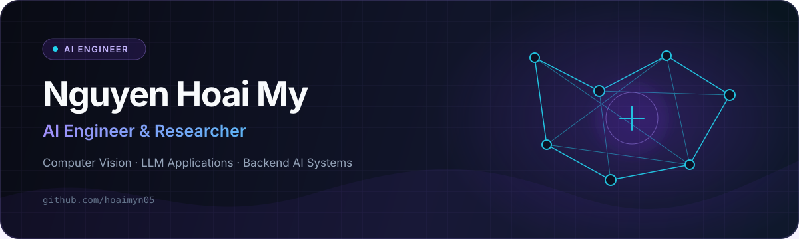

<p align="center">
  
</p>

<p align="center">
  <a href="https://github.com/hoaimyn05"></a>
  <a href="https://hoaimyn05.github.io"></a>
</p>

## Hello, I'm Nguyen Hoai My

I'm an Artificial Intelligence undergraduate at **FPT University**, focused on building practical AI systems from research experiments to deployable products. I work across Computer Vision, LLM-powered workflows, backend AI services, and MLOps-style deployment.

```python
my = {
    "role": "AI Engineer & Researcher",
    "university": "FPT University",
    "location": "Ho Chi Minh City, Vietnam",
    "focus": ["Computer Vision", "LLM Applications", "Agentic AI"],
    "principle": "Turn intelligent models into reliable products."
}
```

### Current direction

- Researching LLMs, machine learning, and computer vision
- Building **Flux AI**, a personal financial coach powered by multi-step LLM orchestration
- Developing secure identity flows with Face Anti-Spoofing and Face Recognition
- Deploying backend AI services with FastAPI, Docker, PostgreSQL, and AWS EC2

### Core stack

<p align="center">
  
</p>

<p align="center">
  
  
  
  
  
  
  
  
  
</p>

### Research, honors & signals

#### Springer LNCS/LNAI — Accepted Paper · Scopus Q2

Weather forecasting system and shelter suggestion for Sydney, Melbourne, and Canberra.

#### Journal of Advances in Information Technology — Accepted Paper

**Insect Detection for Agricultural Pest Removal Using YOLO**  
Indexed by [EI Compendex](http://www.jait.us/), [ESCI](http://www.jait.us/), and [Scopus](http://www.jait.us/).

### Featured work

#### Flux AI — Personal Financial Coach

An AI financial coaching system powered by multi-step LLM orchestration, designed to turn personal financial context into useful, explainable guidance. **In development.**

#### Secure Face Login Pipeline

A secure authentication pipeline combining Face Anti-Spoofing and Face Recognition to reduce presentation attacks before identity matching. **Built; public case study coming soon.**

### Let's connect

I'm open to AI research, engineering internships, student collaborations, and conversations about taking intelligent systems from prototype to production.

<!-- Replace the placeholders below, then remove this comment.
- Email: your-email@example.com
- LinkedIn: https://www.linkedin.com/in/your-handle
-->

<p align="center">
  <sub>Research → Engineer → Deploy · Ho Chi Minh City, Vietnam</sub>
</p>
